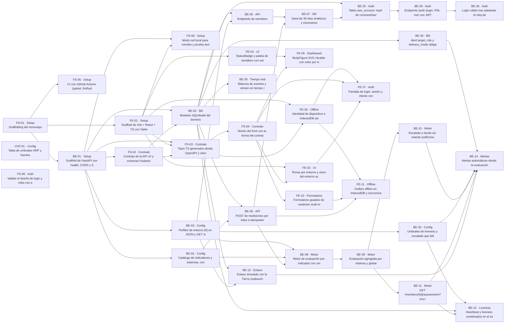

# Backlog

> Generado por `scripts/github/create_issues.py` desde `scripts/github/backlog.yaml`. **No editar a mano**: edita el YAML y vuelve a ejecutar el script.

📋 Kanban: https://github.com/orgs/NASAHACKATON2026FTHEALTH42U/projects/1

**Cómo coger trabajo:** elige la issue de **tu área** con la prioridad más alta (`P0-blocker` → `P1` → `P2`) cuyas dependencias estén cerradas. Asígnatela antes de empezar.

## Componentes
Cada issue pertenece a **un componente**: la parte del sistema que resuelve. Aparece en el título (`[BE-02] 🗄️ BD · …`), en el label `comp:*` y en el campo *Componente* del Kanban.

| Componente | Label | Qué incluye | Issues |
|---|---|---|---|
| ⚙️ **Setup** | `comp:setup` | Setup / Infra (scaffolding, CI, docker) | FS-01, FS-05, FS-08, BE-01, FE-01, BE-32, BE-24 |
| 📜 **Contrato** | `comp:contract` | Contrato API (schemas, tipos TS, mocks) | FS-02, FS-03, FS-04 |
| 🗄️ **BD** | `comp:db` | Base de datos (modelos SQLModel, tablas, seed) | BE-02, BE-07, BE-35 |
| 📚 **Config** | `comp:config` | Catálogos y configuración JSON (entornos, indicadores, textos) | BE-03, BE-04, CNT-01, CNT-02, BE-33, CNT-03, BE-34 |
| 🌐 **API** | `comp:api` | Endpoints REST | BE-05, BE-06 |
| 🧠 **Motor** | `comp:engine` | Motor de evaluación (umbrales, tendencias) | BE-08, BE-09, BE-10, BE-11, BE-31, FS-09 |
| 🚨 **Alertas** | `comp:alerts` | Alertas y escalado (SOS, consola ground) | BE-14, BE-15, BE-17, FE-13, FE-14, FE-16 |
| 📡 **Enlace** | `comp:link` | Enlace simulado con Tierra (retardo, LOS) | BE-13, FE-17 |
| 💓 **Liveness** | `comp:liveness` | Liveness (heartbeat, R U OK?) | BE-12, BE-16, FE-15 |
| 📴 **Offline** | `comp:offline` | Offline y sincronización (IndexedDB, outbox) | FE-30, FE-11, FE-12 |
| 🎨 **UI** | `comp:ui` | UI base, temas y pulido | FE-02, FE-03, FE-04, FE-33, FE-34, FE-26, FE-35 |
| 🫀 **Dashboard** | `comp:dashboard` | Dashboard, cuerpo SVG y gráficas | FE-05, FE-06, FE-07, FE-08, FE-09 |
| 📝 **Formularios** | `comp:forms` | Formularios de medición | FE-10 |
| 🎮 **Juego** | `comp:game` | Rutina y gamificación | BE-18, BE-19, FE-18, BE-23, FE-24, BE-37 |
| 🧘 **Conductual** | `comp:behavioral` | Salud conductual / aislamiento | FE-19, BE-20, BE-21, FE-20, FE-21, FE-22, BE-22, FE-23, FE-25 |
| 📶 **Tiempo real** | `comp:realtime` | Tiempo real y dispositivos (SSE, event_log, device) | BE-28, BE-29, FE-29 |
| 🛰️ **Control** | `comp:control` | Centro de control (vista global y gestión) | BE-30, FE-31, FE-32, FS-07 |
| 🔐 **Auth** | `comp:auth` | Login y roles (acceso por vistas) | FS-06, BE-25, BE-26, FE-27, BE-27, FE-28, BE-36 |
| 🎤 **Pitch** | `comp:pitch` | Pitch, demo y envío | CNT-04 |

## M0 Setup (sáb +2h)

Scaffolding, contrato v0, catálogos. Desbloquea a todo el equipo.

| ID | Componente | Issue | Área | Prio | Depende de | Bloquea |
|---|---|---|---|---|---|---|
| FS-01 | ⚙️ Setup | [#2](https://github.com/NASAHACKATON2026FTHEALTH42U/RUOK/issues/2) Scaffolding del monorepo | fullstack | P0-blocker | — | FS-05, BE-01, FE-01 |
| FS-05 | ⚙️ Setup | [#60](https://github.com/NASAHACKATON2026FTHEALTH42U/RUOK/issues/60) CI con GitHub Actions (pytest, lint/build y contrato) y protección de main | fullstack | P0-blocker | FS-01 | — |
| FS-08 | ⚙️ Setup | [#73](https://github.com/NASAHACKATON2026FTHEALTH42U/RUOK/issues/73) Modo red local para móviles y prueba temprana con 2 dispositivos | fullstack | P0-blocker | BE-01, FE-01 | FE-33 |
| BE-01 | ⚙️ Setup | [#3](https://github.com/NASAHACKATON2026FTHEALTH42U/RUOK/issues/3) Scaffold de FastAPI con health, CORS y SQLite en WAL | backend | P0-blocker | FS-01 | FS-08, FS-02, FS-03, BE-02, BE-03, BE-04, BE-24 |
| FE-01 | ⚙️ Setup | [#4](https://github.com/NASAHACKATON2026FTHEALTH42U/RUOK/issues/4) Scaffold de Vite + React + TS con Tailwind, Router y Zustand | frontend | P0-blocker | FS-01 | FS-08, FS-03, FE-02, FE-04, FE-30, BE-24 |
| FS-02 | 📜 Contrato | [#5](https://github.com/NASAHACKATON2026FTHEALTH42U/RUOK/issues/5) Contrato de la API v0 y schemas Pydantic stub | fullstack | P0-blocker | BE-01 | FS-03, BE-02 |
| FS-03 | 📜 Contrato | [#6](https://github.com/NASAHACKATON2026FTHEALTH42U/RUOK/issues/6) Tipos TS generados desde OpenAPI y cliente API | fullstack | P0-blocker | BE-01, FE-01, FS-02 | FS-04, FE-30 |
| FS-04 | 📜 Contrato | [#7](https://github.com/NASAHACKATON2026FTHEALTH42U/RUOK/issues/7) Mocks del front con la forma del contrato y conmutador mock/real | fullstack | P0-blocker | FS-03 | FE-02, FE-05, FE-08, FE-10, FE-27, FE-13 |
| BE-02 | 🗄️ BD | [#8](https://github.com/NASAHACKATON2026FTHEALTH42U/RUOK/issues/8) Modelos SQLModel del dominio | backend | P0-blocker | BE-01, FS-02 | BE-05, BE-06, BE-25, BE-28, BE-35, BE-32, BE-13, BE-12, BE-18, BE-29 |
| BE-03 | 📚 Config | [#9](https://github.com/NASAHACKATON2026FTHEALTH42U/RUOK/issues/9) Perfiles de entorno (6) en JSON y GET /environments | backend | P0-blocker | BE-01 | BE-05, BE-08, BE-33, BE-13, BE-18, BE-34 |
| BE-04 | 📚 Config | [#10](https://github.com/NASAHACKATON2026FTHEALTH42U/RUOK/issues/10) Catálogo de indicadores y sistemas, con GET /indicators y /systems | backend | P0-blocker | BE-01 | BE-06, BE-08, BE-20, BE-21, BE-34 |
| CNT-01 | 📚 Config | [#11](https://github.com/NASAHACKATON2026FTHEALTH42U/RUOK/issues/11) Tabla de umbrales HRP y fuentes | content | P0-blocker | — | CNT-02, CNT-03 |
| FS-06 | 🔐 Auth | [#65](https://github.com/NASAHACKATON2026FTHEALTH42U/RUOK/issues/65) Validar el diseño de login y roles con el equipo | fullstack | P0-blocker | — | — |

## Hito 1 (sáb noche)

Dashboard con cuerpo + semáforo con datos reales y cambio de entorno.

| ID | Componente | Issue | Área | Prio | Depende de | Bloquea |
|---|---|---|---|---|---|---|
| BE-05 | 🌐 API | [#12](https://github.com/NASAHACKATON2026FTHEALTH42U/RUOK/issues/12) Endpoints de members | backend | P0-blocker | BE-02, BE-03 | BE-07, BE-27 |
| BE-06 | 🌐 API | [#13](https://github.com/NASAHACKATON2026FTHEALTH42U/RUOK/issues/13) POST de mediciones por lotes e idempotente, y GET con filtros | backend | P0-blocker | BE-02, BE-04 | BE-07, BE-08, FE-11, BE-27, FS-09 |
| BE-07 | 🗄️ BD | [#14](https://github.com/NASAHACKATON2026FTHEALTH42U/RUOK/issues/14) Seed de 30 días sintéticos y escenarios de demo | backend | P0-blocker | BE-05, BE-06 | BE-25, BE-37 |
| BE-08 | 🧠 Motor | [#15](https://github.com/NASAHACKATON2026FTHEALTH42U/RUOK/issues/15) Motor de evaluación por indicador con umbrales y ajustes de entorno | backend | P0-blocker | BE-03, BE-04, BE-06 | BE-09, BE-10 |
| BE-09 | 🧠 Motor | [#16](https://github.com/NASAHACKATON2026FTHEALTH42U/RUOK/issues/16) Evaluación agregada por sistema y global con recomendaciones | backend | P0-blocker | BE-08 | BE-11, BE-31 |
| BE-10 | 🧠 Motor | [#17](https://github.com/NASAHACKATON2026FTHEALTH42U/RUOK/issues/17) Tendencias y línea base personal | backend | P1 | BE-08 | BE-20, FS-09 |
| BE-11 | 🧠 Motor | [#18](https://github.com/NASAHACKATON2026FTHEALTH42U/RUOK/issues/18) GET /members/{id}/assessment?env= | backend | P0-blocker | BE-09 | BE-14, BE-12, BE-30 |
| FE-02 | 🎨 UI | [#19](https://github.com/NASAHACKATON2026FTHEALTH42U/RUOK/issues/19) Temas por entorno y store del entorno activo | frontend | P0-blocker | FE-01, FS-04 | FE-03, FE-27, FE-21 |
| FE-03 | 🎨 UI | [#20](https://github.com/NASAHACKATON2026FTHEALTH42U/RUOK/issues/20) Página de selección de entorno con transición | frontend | P1 | FE-02 | — |
| FE-04 | 🎨 UI | [#21](https://github.com/NASAHACKATON2026FTHEALTH42U/RUOK/issues/21) StatusBadge y paleta de semáforo con estado unknown/stale | frontend | P0-blocker | FE-01 | FE-05, FE-08, FE-12, FE-34 |
| FE-05 | 🫀 Dashboard | [#22](https://github.com/NASAHACKATON2026FTHEALTH42U/RUOK/issues/22) BodyFigure SVG clicable con color por sistema | frontend | P0-blocker | FE-04, FS-04 | FE-06, FE-07 |
| FE-06 | 🫀 Dashboard | [#23](https://github.com/NASAHACKATON2026FTHEALTH42U/RUOK/issues/23) SystemPanel con el detalle de cada sistema | frontend | P1 | FE-05 | — |
| FE-07 | 🫀 Dashboard | [#24](https://github.com/NASAHACKATON2026FTHEALTH42U/RUOK/issues/24) Layout del dashboard | frontend | P1 | FE-05 | FE-28, FE-33, FE-34, FE-26 |
| FE-08 | 🫀 Dashboard | [#25](https://github.com/NASAHACKATON2026FTHEALTH42U/RUOK/issues/25) IndicatorCard y TrendChart con bandas de umbral | frontend | P1 | FE-04, FS-04 | FE-09 |
| FE-10 | 📝 Formularios | [#26](https://github.com/NASAHACKATON2026FTHEALTH42U/RUOK/issues/26) Formularios guiados de medición multi-indicador | frontend | P0-blocker | FS-04 | FE-19, FE-11, FE-22 |
| FE-19 | 🧘 Conductual | [#27](https://github.com/NASAHACKATON2026FTHEALTH42U/RUOK/issues/27) Check-in diario conductual "R U OK?" | frontend | P1 | FE-10 | — |
| BE-20 | 🧘 Conductual | [#28](https://github.com/NASAHACKATON2026FTHEALTH42U/RUOK/issues/28) Indicadores conductuales, regla de línea base y privacidad | backend | P1 | BE-10, BE-04 | — |
| CNT-02 | 📚 Config | [#29](https://github.com/NASAHACKATON2026FTHEALTH42U/RUOK/issues/29) Textos por sistema e indicador e instrucciones de medición | content | P1 | CNT-01 | — |
| BE-25 | 🔐 Auth | [#66](https://github.com/NASAHACKATON2026FTHEALTH42U/RUOK/issues/66) Tabla user_account, hash de contraseñas/PIN y usuarios demo | backend | P0-blocker | BE-02, BE-07 | BE-26 |
| BE-26 | 🔐 Auth | [#67](https://github.com/NASAHACKATON2026FTHEALTH42U/RUOK/issues/67) Endpoints /auth (login, PIN, me) con JWT local | backend | P0-blocker | BE-25 | BE-27, BE-36 |
| FE-27 | 🔐 Auth | [#68](https://github.com/NASAHACKATON2026FTHEALTH42U/RUOK/issues/68) Pantalla de login, sesión y cliente con token | frontend | P0-blocker | FE-30, FS-04, FE-02 | FE-28, FE-29, FE-35 |
| FE-30 | 📴 Offline | [#74](https://github.com/NASAHACKATON2026FTHEALTH42U/RUOK/issues/74) Identidad de dispositivo e IndexedDB aislada por dispositivo/pestaña | frontend | P0-blocker | FE-01, FS-03 | FE-27, FE-11, FE-15 |
| BE-28 | 📶 Tiempo real | [#75](https://github.com/NASAHACKATON2026FTHEALTH42U/RUOK/issues/75) Bitácora de eventos y stream en tiempo real (SSE) | backend | P0-blocker | BE-02 | FE-29 |
| BE-31 | 🧠 Motor | [#111](https://github.com/NASAHACKATON2026FTHEALTH42U/RUOK/issues/111) Escalado a bordo sin retardo (self/crew en tiempo real) | backend | P0-blocker | BE-09 | BE-14 |
| BE-33 | 📚 Config | [#112](https://github.com/NASAHACKATON2026FTHEALTH42U/RUOK/issues/112) Umbrales de liveness y escalado que faltan en environments.json | backend | P0-blocker | BE-03 | BE-14, BE-12, BE-16 |
| BE-35 | 🗄️ BD | [#113](https://github.com/NASAHACKATON2026FTHEALTH42U/RUOK/issues/113) Alert.target_role y delivery_mode obligatorios en el modelo | backend | P0-blocker | BE-02 | BE-14 |
| BE-32 | ⚙️ Setup | [#114](https://github.com/NASAHACKATON2026FTHEALTH42U/RUOK/issues/114) Persistir el reloj de demo en fast-forward y reset | backend | P1 | BE-02 | — |

## Hito 2 (dom 09:00)

MVP integrado: alertas, offline, liveness, gamificación, consola ground.

| ID | Componente | Issue | Área | Prio | Depende de | Bloquea |
|---|---|---|---|---|---|---|
| BE-13 | 📡 Enlace | [#30](https://github.com/NASAHACKATON2026FTHEALTH42U/RUOK/issues/30) Enlace simulado con la Tierra (outbox/inbox, retardo, LOS) | backend | P0-blocker | BE-02, BE-03 | BE-14, BE-17, FE-17, BE-30, BE-22 |
| BE-14 | 🚨 Alertas | [#31](https://github.com/NASAHACKATON2026FTHEALTH42U/RUOK/issues/31) Alertas automáticas desde la evaluación con deduplicación y escalera | backend | P0-blocker | BE-35, BE-33, BE-31, BE-11, BE-13 | BE-15, BE-16 |
| BE-15 | 🚨 Alertas | [#32](https://github.com/NASAHACKATON2026FTHEALTH42U/RUOK/issues/32) Alertas manuales (crear, escalar, ack, resolve, mensajes) | backend | P1 | BE-14 | BE-17, FE-14, BE-27 |
| BE-12 | 💓 Liveness | [#33](https://github.com/NASAHACKATON2026FTHEALTH42U/RUOK/issues/33) Heartbeat y liveness combinados en el estado global | backend | P0-blocker | BE-33, BE-02, BE-11 | BE-16, FE-15, BE-29, BE-30 |
| BE-16 | 💓 Liveness | [#34](https://github.com/NASAHACKATON2026FTHEALTH42U/RUOK/issues/34) Alerta no_contact y timeout del check-in "R U OK?" | backend | P1 | BE-33, BE-12, BE-14 | — |
| BE-17 | 🚨 Alertas | [#35](https://github.com/NASAHACKATON2026FTHEALTH42U/RUOK/issues/35) Endpoint de la consola ground con estado as-of y filtro de privacidad | backend | P1 | BE-15, BE-13 | FE-16, BE-27 |
| BE-18 | 🎮 Juego | [#36](https://github.com/NASAHACKATON2026FTHEALTH42U/RUOK/issues/36) Rutina de tareas diarias desde el perfil del entorno | backend | P1 | BE-02, BE-03 | BE-19 |
| BE-19 | 🎮 Juego | [#37](https://github.com/NASAHACKATON2026FTHEALTH42U/RUOK/issues/37) Gamificación (puntos, rachas, insignias, leaderboard cooperativo) | backend | P1 | BE-18 | FE-18, BE-23, BE-37 |
| BE-21 | 🧘 Conductual | [#38](https://github.com/NASAHACKATON2026FTHEALTH42U/RUOK/issues/38) Catálogo de intervenciones y GET /interventions | backend | P1 | BE-04 | FE-20 |
| BE-24 | ⚙️ Setup | [#39](https://github.com/NASAHACKATON2026FTHEALTH42U/RUOK/issues/39) FastAPI sirve el build del front y docker-compose | fullstack | P1 | BE-01, FE-01 | — |
| FE-09 | 🫀 Dashboard | [#40](https://github.com/NASAHACKATON2026FTHEALTH42U/RUOK/issues/40) Página de historial (7/30 días) | frontend | P1 | FE-08 | FS-09 |
| FE-11 | 📴 Offline | [#41](https://github.com/NASAHACKATON2026FTHEALTH42U/RUOK/issues/41) Outbox offline en IndexedDB y sincronización | frontend | P0-blocker | FE-30, FE-10, BE-06 | FE-12, FE-13 |
| FE-12 | 📴 Offline | [#42](https://github.com/NASAHACKATON2026FTHEALTH42U/RUOK/issues/42) Semáforo provisional offline | frontend | P1 | FE-11, FE-04 | — |
| FE-13 | 🚨 Alertas | [#43](https://github.com/NASAHACKATON2026FTHEALTH42U/RUOK/issues/43) Botón SOS / Pedir ayuda | frontend | P1 | FS-04, FE-11 | FE-14 |
| FE-14 | 🚨 Alertas | [#44](https://github.com/NASAHACKATON2026FTHEALTH42U/RUOK/issues/44) Panel de alertas con timeline, escalado, ETA y protocolo autónomo | frontend | P1 | BE-34, FE-29, FE-13, BE-15 | FE-16, FE-35 |
| FE-15 | 💓 Liveness | [#45](https://github.com/NASAHACKATON2026FTHEALTH42U/RUOK/issues/45) Heartbeat del cliente y modal "R U OK?" | frontend | P1 | FE-30, BE-12 | — |
| FE-16 | 🚨 Alertas | [#46](https://github.com/NASAHACKATON2026FTHEALTH42U/RUOK/issues/46) Consola /ground con estado as-of | frontend | P1 | FE-29, FE-28, FE-14, BE-17 | — |
| FE-17 | 📡 Enlace | [#47](https://github.com/NASAHACKATON2026FTHEALTH42U/RUOK/issues/47) Indicador del estado del enlace en la cabecera | frontend | P1 | FE-28, BE-13 | FE-32 |
| FE-18 | 🎮 Juego | [#48](https://github.com/NASAHACKATON2026FTHEALTH42U/RUOK/issues/48) UI de misiones diarias, puntos, racha e insignias | frontend | P1 | BE-19 | — |
| FE-20 | 🧘 Conductual | [#49](https://github.com/NASAHACKATON2026FTHEALTH42U/RUOK/issues/49) Tarjetas de intervención | frontend | P1 | BE-21 | — |
| FE-21 | 🧘 Conductual | [#50](https://github.com/NASAHACKATON2026FTHEALTH42U/RUOK/issues/50) Barra de fase de misión y aviso del tercer cuarto | frontend | P1 | FE-02 | — |
| CNT-03 | 📚 Config | [#51](https://github.com/NASAHACKATON2026FTHEALTH42U/RUOK/issues/51) Contenido de las intervenciones y los protocolos autónomos | content | P1 | CNT-01 | — |
| BE-27 | 🔐 Auth | [#69](https://github.com/NASAHACKATON2026FTHEALTH42U/RUOK/issues/69) Autorización por rol y propiedad en todos los endpoints | backend | P1 | BE-26, BE-05, BE-06, BE-15, BE-17 | FS-07 |
| FE-28 | 🔐 Auth | [#70](https://github.com/NASAHACKATON2026FTHEALTH42U/RUOK/issues/70) Guards de rutas y menús según el rol | frontend | P1 | FE-27, FE-07 | FE-16, FE-17, FE-31, FS-07, FE-35 |
| BE-29 | 📶 Tiempo real | [#76](https://github.com/NASAHACKATON2026FTHEALTH42U/RUOK/issues/76) Registro de dispositivos | backend | P1 | BE-02, BE-12 | BE-30 |
| BE-30 | 🛰️ Control | [#77](https://github.com/NASAHACKATON2026FTHEALTH42U/RUOK/issues/77) Endpoints del centro de control y descubrimiento en red | backend | P1 | BE-11, BE-12, BE-13, BE-29 | FE-31 |
| FE-29 | 📶 Tiempo real | [#78](https://github.com/NASAHACKATON2026FTHEALTH42U/RUOK/issues/78) Cliente de tiempo real (SSE) con fallback a polling | frontend | P1 | FE-27, BE-28 | FE-14, FE-16, FE-31 |
| FE-31 | 🛰️ Control | [#79](https://github.com/NASAHACKATON2026FTHEALTH42U/RUOK/issues/79) Centro de control (/control) con vista global y flujo de datos en vivo | frontend | P1 | FE-28, FE-29, BE-30 | FE-32, FS-07 |
| FE-32 | 🛰️ Control | [#80](https://github.com/NASAHACKATON2026FTHEALTH42U/RUOK/issues/80) Gestión en el centro de control (demo, entornos, QR) | frontend | P1 | FE-31, FE-17 | — |
| FE-33 | 🎨 UI | [#81](https://github.com/NASAHACKATON2026FTHEALTH42U/RUOK/issues/81) Vistas de member y medic mobile-first probadas en móvil real | frontend | P1 | FE-07, FS-08 | — |
| BE-34 | 📚 Config | [#115](https://github.com/NASAHACKATON2026FTHEALTH42U/RUOK/issues/115) Validación cruzada de threshold_overrides y vocabulario de la escalera | backend | P1 | BE-03, BE-04 | FE-14 |
| FE-34 | 🎨 UI | [#116](https://github.com/NASAHACKATON2026FTHEALTH42U/RUOK/issues/116) Correcciones de reglas del front detectadas en la revisión | frontend | P1 | FE-04, FE-07 | — |
| FE-22 | 🧘 Conductual | [#52](https://github.com/NASAHACKATON2026FTHEALTH42U/RUOK/issues/52) Test de vigilancia psicomotora (PVT) | fullstack | P1 | FE-10 | — |
| FS-07 | 🛰️ Control | [#71](https://github.com/NASAHACKATON2026FTHEALTH42U/RUOK/issues/71) Gestión de usuarios en el centro de control (y rol family P2) | fullstack | P1 | BE-27, FE-28, FE-31 | — |
| BE-36 | 🔐 Auth | [#170](https://github.com/NASAHACKATON2026FTHEALTH42U/RUOK/issues/170) Login válido tras adelantar el reloj de la demo (iat con clock.now()) | backend | P0-blocker | BE-26 | — |
| BE-37 | 🎮 Juego | [#171](https://github.com/NASAHACKATON2026FTHEALTH42U/RUOK/issues/171) Historial de rutina y juego en el seed (rachas, insignias y puntos variados) | backend | P1 | BE-07, BE-19 | — |

## Freeze (dom 11:00)

P2 y pulido. Lo no terminado a las 11:00 se corta.

| ID | Componente | Issue | Área | Prio | Depende de | Bloquea |
|---|---|---|---|---|---|---|
| BE-22 | 🧘 Conductual | [#53](https://github.com/NASAHACKATON2026FTHEALTH42U/RUOK/issues/53) Backend de "Mensaje a casa" por el enlace | backend | P2 | BE-13 | FE-23 |
| FE-23 | 🧘 Conductual | [#54](https://github.com/NASAHACKATON2026FTHEALTH42U/RUOK/issues/54) UI de "Mensaje a casa" | frontend | P2 | BE-22 | — |
| BE-23 | 🎮 Juego | [#55](https://github.com/NASAHACKATON2026FTHEALTH42U/RUOK/issues/55) Backend de kudos y misiones de tripulación | backend | P2 | BE-19 | FE-24 |
| FE-24 | 🎮 Juego | [#56](https://github.com/NASAHACKATON2026FTHEALTH42U/RUOK/issues/56) UI de kudos y misiones de tripulación | frontend | P2 | BE-23 | — |
| FE-25 | 🧘 Conductual | [#57](https://github.com/NASAHACKATON2026FTHEALTH42U/RUOK/issues/57) Galería Earth view | frontend | P2 | — | — |
| FE-26 | 🎨 UI | [#58](https://github.com/NASAHACKATON2026FTHEALTH42U/RUOK/issues/58) Pulido de animaciones, responsive y disclaimer médico | frontend | P1 | FE-07 | — |
| CNT-04 | 🎤 Pitch | [#59](https://github.com/NASAHACKATON2026FTHEALTH42U/RUOK/issues/59) Guion, slides, vídeo y envío a Space Apps | content | P1 | — | — |
| FE-35 | 🎨 UI | [#210](https://github.com/NASAHACKATON2026FTHEALTH42U/RUOK/issues/210) Admin como cuenta de supervisión (selector de member, alertas del entorno, estados vacíos útiles) | frontend | P2 | FE-27, FE-28, FE-14 | — |
| FS-09 | 🧠 Motor | [#227](https://github.com/NASAHACKATON2026FTHEALTH42U/RUOK/issues/227) Previsión de valores esperados por indicador (modelo Holt amortiguado, 100 % local) | fullstack | P2 | BE-10, BE-06, FE-09 | — |

## Ruta crítica (P0)

