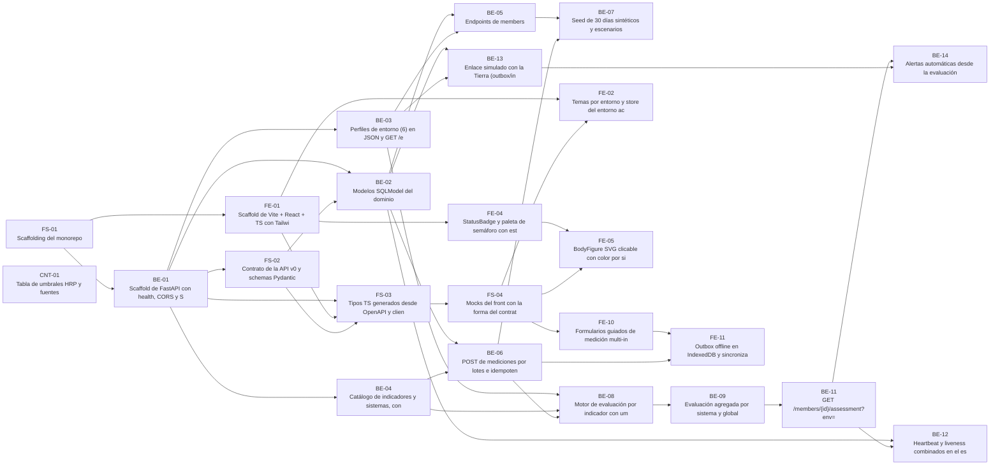

# Backlog

> Generado por `scripts/github/create_issues.py` desde `scripts/github/backlog.yaml`. **No editar a mano**: edita el YAML y vuelve a ejecutar el script.

**Cómo coger trabajo:** elige la issue de **tu área** con prioridad más alta (`P0-blocker` → `P1` → `P2`) cuyas dependencias estén cerradas. Asígnatela antes de empezar.

Leyenda: `P0-blocker` = genera dependencias, hacer primero · `P1` = MVP · `P2` = si da tiempo (se corta en el freeze).

## M0 Setup (sáb +2h)

Scaffolding, contrato v0, catálogos. Desbloquea a todo el equipo.

| ID | Issue | Área | Prio | Depende de | Bloquea |
|---|---|---|---|---|---|
| FS-01 | — Scaffolding del monorepo | fullstack | P0-blocker | — | BE-01, FE-01 |
| BE-01 | — Scaffold de FastAPI con health, CORS y SQLite en WAL | backend | P0-blocker | FS-01 | FS-02, FS-03, BE-02, BE-03, BE-04, BE-24 |
| FE-01 | — Scaffold de Vite + React + TS con Tailwind, Router y Zustand | frontend | P0-blocker | FS-01 | FS-03, FE-02, FE-04, BE-24 |
| FS-02 | — Contrato de la API v0 y schemas Pydantic stub | fullstack | P0-blocker | BE-01 | FS-03, BE-02 |
| FS-03 | — Tipos TS generados desde OpenAPI y cliente API | fullstack | P0-blocker | BE-01, FE-01, FS-02 | FS-04 |
| FS-04 | — Mocks del front con la forma del contrato y conmutador mock/real | fullstack | P0-blocker | FS-03 | FE-02, FE-05, FE-08, FE-10, FE-13 |
| BE-02 | — Modelos SQLModel del dominio | backend | P0-blocker | BE-01, FS-02 | BE-05, BE-06, BE-13, BE-12, BE-18 |
| BE-03 | — Perfiles de entorno (6) en JSON y GET /environments | backend | P0-blocker | BE-01 | BE-05, BE-08, BE-13, BE-18 |
| BE-04 | — Catálogo de indicadores y sistemas, con GET /indicators y /systems | backend | P0-blocker | BE-01 | BE-06, BE-08, BE-20, BE-21 |
| CNT-01 | — Tabla de umbrales HRP y fuentes | content | P0-blocker | — | CNT-02, CNT-03 |

## Hito 1 (sáb noche)

Dashboard con cuerpo + semáforo con datos reales y cambio de entorno.

| ID | Issue | Área | Prio | Depende de | Bloquea |
|---|---|---|---|---|---|
| BE-05 | — Endpoints de members | backend | P0-blocker | BE-02, BE-03 | BE-07 |
| BE-06 | — POST de mediciones por lotes e idempotente, y GET con filtros | backend | P0-blocker | BE-02, BE-04 | BE-07, BE-08, FE-11 |
| BE-07 | — Seed de 30 días sintéticos y escenarios de demo | backend | P0-blocker | BE-05, BE-06 | — |
| BE-08 | — Motor de evaluación por indicador con umbrales y ajustes de entorno | backend | P0-blocker | BE-03, BE-04, BE-06 | BE-09, BE-10 |
| BE-09 | — Evaluación agregada por sistema y global con recomendaciones | backend | P0-blocker | BE-08 | BE-11 |
| BE-10 | — Tendencias y línea base personal | backend | P1 | BE-08 | BE-20 |
| BE-11 | — GET /members/{id}/assessment?env= | backend | P0-blocker | BE-09 | BE-14, BE-12 |
| FE-02 | — Temas por entorno y store del entorno activo | frontend | P0-blocker | FE-01, FS-04 | FE-03, FE-21 |
| FE-03 | — Página de selección de entorno con transición | frontend | P1 | FE-02 | — |
| FE-04 | — StatusBadge y paleta de semáforo con estado unknown/stale | frontend | P0-blocker | FE-01 | FE-05, FE-08, FE-12 |
| FE-05 | — BodyFigure SVG clicable con color por sistema | frontend | P0-blocker | FE-04, FS-04 | FE-06, FE-07 |
| FE-06 | — SystemPanel con el detalle de cada sistema | frontend | P1 | FE-05 | — |
| FE-07 | — Layout del dashboard | frontend | P1 | FE-05 | FE-26 |
| FE-08 | — IndicatorCard y TrendChart con bandas de umbral | frontend | P1 | FE-04, FS-04 | FE-09 |
| FE-10 | — Formularios guiados de medición multi-indicador | frontend | P0-blocker | FS-04 | FE-19, FE-11, FE-22 |
| FE-19 | — Check-in diario conductual "R U OK?" | frontend | P1 | FE-10 | — |
| BE-20 | — Indicadores conductuales, regla de línea base y privacidad | backend | P1 | BE-10, BE-04 | — |
| CNT-02 | — Textos por sistema e indicador e instrucciones de medición | content | P1 | CNT-01 | — |

## Hito 2 (dom 09:00)

MVP integrado: alertas, offline, liveness, gamificación, consola ground.

| ID | Issue | Área | Prio | Depende de | Bloquea |
|---|---|---|---|---|---|
| BE-13 | — Enlace simulado con la Tierra (outbox/inbox, retardo, LOS) | backend | P0-blocker | BE-02, BE-03 | BE-14, BE-17, FE-17, BE-22 |
| BE-14 | — Alertas automáticas desde la evaluación con deduplicación y escalera | backend | P0-blocker | BE-11, BE-13 | BE-15, BE-16 |
| BE-15 | — Alertas manuales (crear, escalar, ack, resolve, mensajes) | backend | P1 | BE-14 | BE-17, FE-14 |
| BE-12 | — Heartbeat y liveness combinados en el estado global | backend | P0-blocker | BE-02, BE-11 | BE-16, FE-15 |
| BE-16 | — Alerta no_contact y timeout del check-in "R U OK?" | backend | P1 | BE-12, BE-14 | — |
| BE-17 | — Endpoint de la consola ground con estado as-of y filtro de privacidad | backend | P1 | BE-15, BE-13 | FE-16 |
| BE-18 | — Rutina de tareas diarias desde el perfil del entorno | backend | P1 | BE-02, BE-03 | BE-19 |
| BE-19 | — Gamificación (puntos, rachas, insignias, leaderboard cooperativo) | backend | P1 | BE-18 | FE-18, BE-23 |
| BE-21 | — Catálogo de intervenciones y GET /interventions | backend | P1 | BE-04 | FE-20 |
| BE-24 | — FastAPI sirve el build del front y docker-compose | fullstack | P1 | BE-01, FE-01 | — |
| FE-09 | — Página de historial (7/30 días) | frontend | P1 | FE-08 | — |
| FE-11 | — Outbox offline en IndexedDB y sincronización | frontend | P0-blocker | FE-10, BE-06 | FE-12, FE-13 |
| FE-12 | — Semáforo provisional offline | frontend | P1 | FE-11, FE-04 | — |
| FE-13 | — Botón SOS / Pedir ayuda | frontend | P1 | FS-04, FE-11 | FE-14 |
| FE-14 | — Panel de alertas con timeline, escalado, ETA y protocolo autónomo | frontend | P1 | FE-13, BE-15 | FE-16 |
| FE-15 | — Heartbeat del cliente y modal "R U OK?" | frontend | P1 | BE-12 | — |
| FE-16 | — Consola /ground con estado as-of | frontend | P1 | FE-14, BE-17 | — |
| FE-17 | — Indicador del estado del enlace y controles de demo | frontend | P1 | BE-13 | — |
| FE-18 | — UI de misiones diarias, puntos, racha e insignias | frontend | P1 | BE-19 | — |
| FE-20 | — Tarjetas de intervención | frontend | P1 | BE-21 | — |
| FE-21 | — Barra de fase de misión y aviso del tercer cuarto | frontend | P1 | FE-02 | — |
| CNT-03 | — Contenido de las intervenciones y los protocolos autónomos | content | P1 | CNT-01 | — |

## Freeze (dom 11:00)

P2 y pulido. Lo no terminado a las 11:00 se corta.

| ID | Issue | Área | Prio | Depende de | Bloquea |
|---|---|---|---|---|---|
| FE-22 | — Test de vigilancia psicomotora (PVT) | fullstack | P2 | FE-10 | — |
| BE-22 | — Backend de "Mensaje a casa" por el enlace | backend | P2 | BE-13 | FE-23 |
| FE-23 | — UI de "Mensaje a casa" | frontend | P2 | BE-22 | — |
| BE-23 | — Backend de kudos y misiones de tripulación | backend | P2 | BE-19 | FE-24 |
| FE-24 | — UI de kudos y misiones de tripulación | frontend | P2 | BE-23 | — |
| FE-25 | — Galería Earth view | frontend | P2 | — | — |
| FE-26 | — Pulido de animaciones, responsive y disclaimer médico | frontend | P1 | FE-07 | — |
| CNT-04 | — Guion, slides, vídeo y envío a Space Apps | content | P1 | — | — |

## Ruta crítica (P0)

