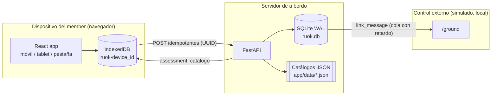
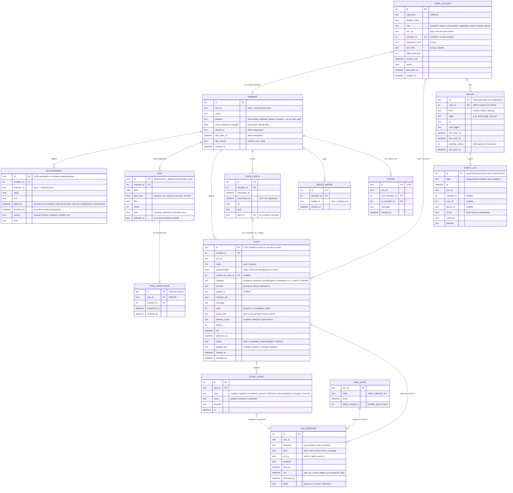
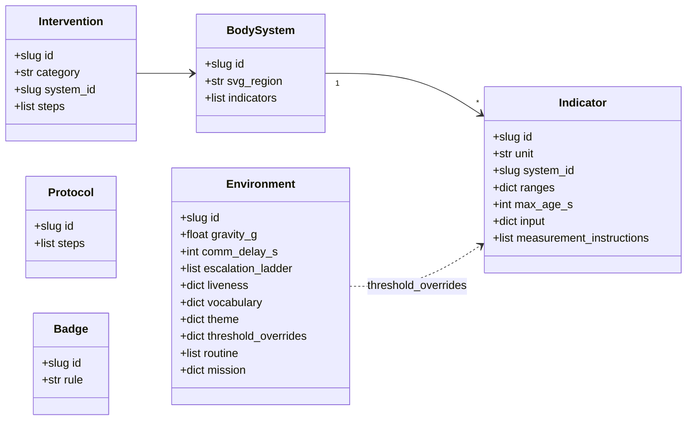
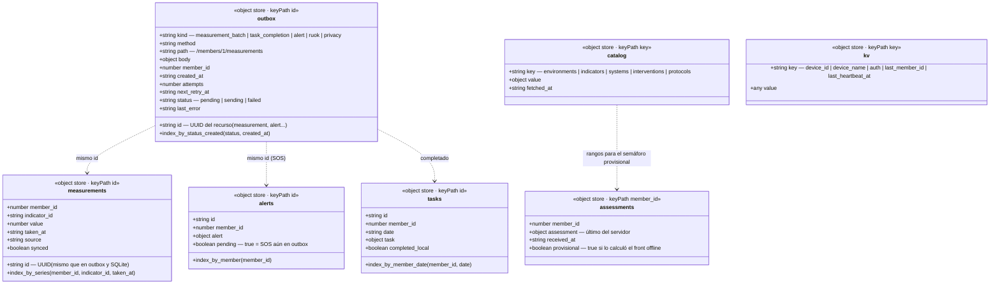
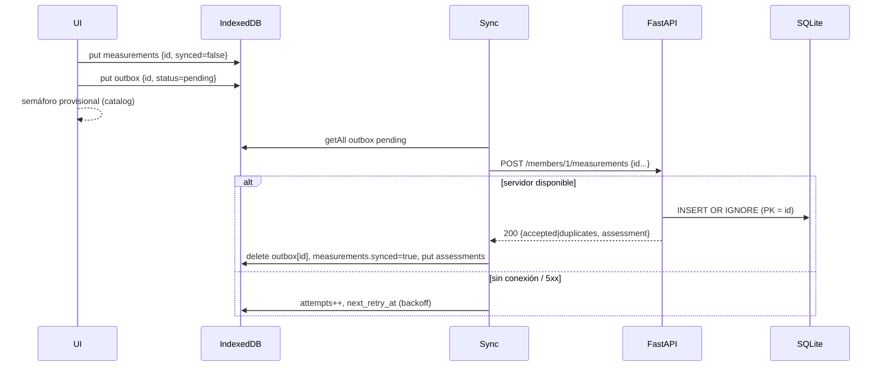

# Modelo de datos: SQLite (servidor de a bordo) e IndexedDB (dispositivo)

> Diseño de referencia para **BE-02** (modelos SQLModel) y **FE-11** (outbox offline). Si cambias una tabla o un store, actualiza este documento en la misma PR.

## Visión general



Hay tres capas de datos:
1. **Catálogos JSON** (solo lectura, versionados en git): entornos, indicadores, sistemas, intervenciones, protocolos e insignias. **No son tablas.** Las tablas los referencian por *slug* (`env_id`, `indicator_id`…).
2. **SQLite**: datos operativos de la misión. Es la fuente de verdad.
3. **IndexedDB**: outbox y caché del dispositivo, para que **no se pierda nada** sin conexión. Es una réplica parcial y no es fuente de verdad.

---

## 1. SQLite: `backend/ruok.db`

### Diagrama entidad-relación



Hay además una tabla técnica, fuera del diagrama: **`app_state`** (`key TEXT PK`, `value JSON`). Guarda el offset del reloj de demo (`clock_offset_s`), la versión del seed y el escenario activo.

### Diccionario y reglas por tabla

| Tabla | Notas clave | Issue |
|---|---|---|
| `user_account` | Login local. `UNIQUE(username)` y `UNIQUE(member_id)`. Bloqueo de PIN con `failed_attempts`/`locked_until`. Ver [auth-and-roles.md](auth-and-roles.md). | BE-25, BE-26 |
| `member` | Cada entorno tiene sus members (`env_id`). `last_seen_at` lo actualiza el heartbeat y de él se deriva el liveness (no se guarda). | BE-02, BE-05, BE-12 |
| `measurement` | **Solo se añade, nunca se edita.** La PK es el UUID del cliente: un reintento con el mismo `id` y el mismo contenido devuelve 200, y con contenido distinto, 409. El check-in y el PVT también son measurements (`source`). | BE-06, BE-20 |
| `task` | Se genera cada día desde `environment.routine`. El `id` determinista evita duplicados si la generación se repite. | BE-18 |
| `task_completion` | `UNIQUE(task_id)`: una tarea se completa una sola vez. Los puntos y las rachas **se calculan** a partir de aquí y no se guardan. | BE-18, BE-19 |
| `alert` | Hay como máximo **una alerta abierta por `dedupe_key`** (índice único parcial). `level` es el índice dentro de la escalera del entorno. | BE-14, BE-15 |
| `alert_event` | Timeline *append-only*, que el front muestra tal cual. | BE-14, BE-15 |
| `ruok_check` | Se crea al pasar a `stale`. Si llega el timeout sin `responded_at`, se crea la alerta `no_contact`. | BE-16 |
| `link_message` | Outbox/inbox **persistente** del enlace simulado. Se entrega cuando `now() >= eta` y el enlace no está en `los`. Sobrevive a reinicios. | BE-13 |
| `link_state` | Una fila por entorno, modificable desde `/demo/link`. | BE-13 |
| `badge_award` | `UNIQUE(member_id, badge_id)`. | BE-19 |
| `kudos` | P2. | BE-23 |
| `device` | Una fila por dispositivo (móvil, tablet, pestaña). Se actualiza con cada heartbeat o petición (`X-Device-Id`). | BE-29 |
| `event_log` | Bitácora *append-only* de todo lo que ocurre. Alimenta el SSE y el centro de control. Se purga a los 7 días. | BE-28 |

### Índices y restricciones

```sql
PRAGMA journal_mode = WAL;
PRAGMA foreign_keys = ON;

CREATE UNIQUE INDEX ux_user_username     ON user_account(username);
CREATE UNIQUE INDEX ux_user_member       ON user_account(member_id) WHERE member_id IS NOT NULL;
CREATE INDEX ix_member_env              ON member(env_id);
CREATE INDEX ix_measurement_series      ON measurement(member_id, indicator_id, taken_at);
CREATE INDEX ix_task_member_date        ON task(member_id, date);
CREATE UNIQUE INDEX ux_task_completion  ON task_completion(task_id);
CREATE INDEX ix_alert_member_status     ON alert(member_id, status);
CREATE INDEX ix_alert_env_delivered     ON alert(env_id, delivered_at);
CREATE UNIQUE INDEX ux_alert_open_dedupe ON alert(dedupe_key) WHERE status <> 'resolved';
CREATE INDEX ix_alert_event_alert       ON alert_event(alert_id, at);
CREATE INDEX ix_ruok_member_pending     ON ruok_check(member_id) WHERE responded_at IS NULL;
CREATE INDEX ix_link_due                ON link_message(env_id, state, eta);
CREATE UNIQUE INDEX ux_badge_award      ON badge_award(member_id, badge_id);
CREATE INDEX ix_device_user            ON device(user_id, last_seen_at);
CREATE INDEX ix_event_env_id           ON event_log(env_id, id);
CREATE INDEX ix_event_type_at          ON event_log(type, at);
```

**Convenciones:**
- Todas las fechas se guardan en UTC, en ISO-8601, y se obtienen siempre con `clock.now()`.
- Los campos `json` se guardan como TEXT con `sa_type=JSON` en SQLModel.
- `event_log` **no declara claves foráneas a propósito**: es una bitácora *append-only* que no debe fallar si se borra un member o un dispositivo. Las relaciones del diagrama son lógicas.

### Catálogos JSON referenciados (no son tablas)



`member.env_id`, `measurement.indicator_id`, `alert.system_id`, `badge_award.badge_id` y `task.task_type` se validan contra estos catálogos en la capa de servicio, porque no hay claves foráneas a JSON.

---

## 2. IndexedDB: una base por dispositivo, `ruok-<device_id>` (v1, librería `idb`)

> El `device_id` se guarda en `localStorage` (dispositivo real) o en `sessionStorage` (cada pestaña es un dispositivo, para ensayos). Con `?device=<nombre>` se fija uno con nombre. Ver [control-center-and-devices.md](control-center-and-devices.md#4-identidad-de-dispositivo-y-aislamiento).

Un dispositivo puede trabajar sin el servidor de a bordo. IndexedDB guarda:
- **qué falta por enviar** (outbox);
- **lo necesario para seguir funcionando** (catálogo, último assessment, protocolos).



### Reglas
| Store | Escribe | Lee | Se purga |
|---|---|---|---|
| `outbox` | Todas las escrituras del front, **antes** de llamar a la API | El sincronizador (evento `online` + backoff) | Al recibir 2xx, incluida la respuesta "duplicado" |
| `measurements` | Al registrar una medición (`synced=false`) y al descargar el historial | Historial y gráficas offline, semáforo provisional | Se conservan 30 días |
| `assessments` | Respuesta del servidor, o el cálculo provisional | Dashboard sin conexión | Se sobrescribe |
| `catalog` | Al arrancar con conexión | Formularios, rangos, protocolos e intervenciones offline | Se sobrescribe |
| `alerts` | SOS local (`pending=true`) y alertas del servidor | Panel de alertas y aviso "No enviado" | Las resueltas, a los 7 días |
| `tasks` | Tareas del día y completados locales | Misiones offline | Se conservan los días anteriores al de hoy menos 2 |
| `kv` | `device_id` (UUID generado una vez), `device_name` (`?device=`), `auth` = `{token, user, exp}` (FE-27) y `last_member_id` (para el SOS sin sesión). **La sesión de la UI** (entorno, member, vocabulario: store Zustand) **no va aquí**: se guarda en `localStorage` con la clave `ruok-session-<device_id>` (FE-02/FE-30) | Toda la app | `auth` se borra al cerrar sesión. El outbox **nunca** se borra por un logout o un 401 |

### Flujo de sincronización



**Garantía:** el `id` es el mismo en IndexedDB, en el cuerpo de la petición y en la PK de SQLite. Reintentar es seguro: no se duplican datos ni hay conflictos, porque todo es *append-only*.
