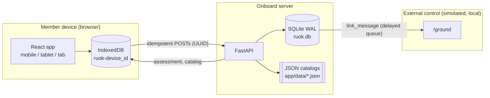
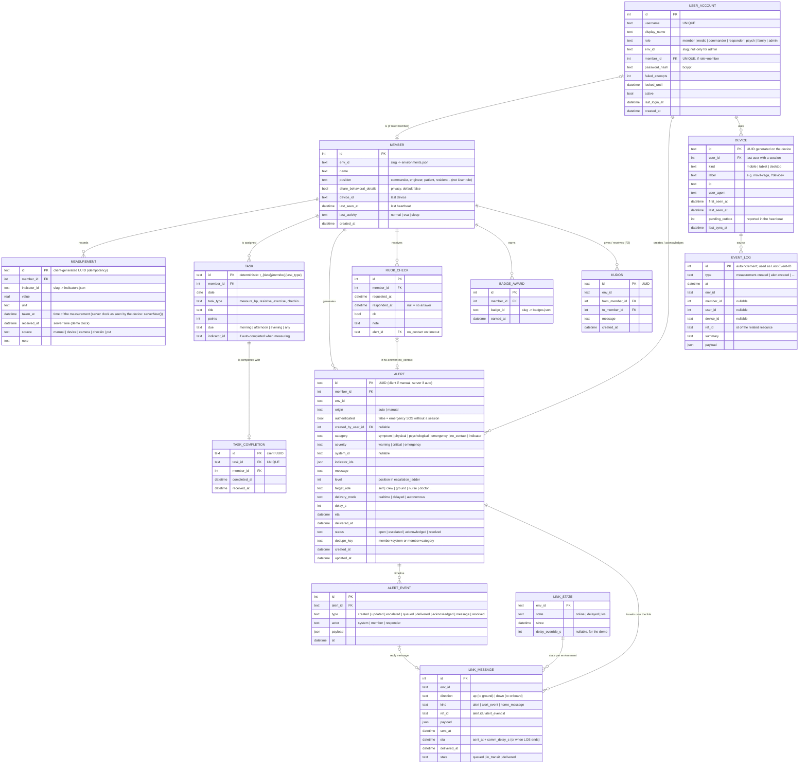
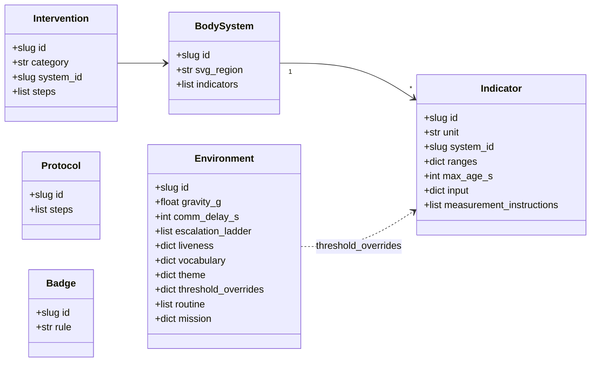
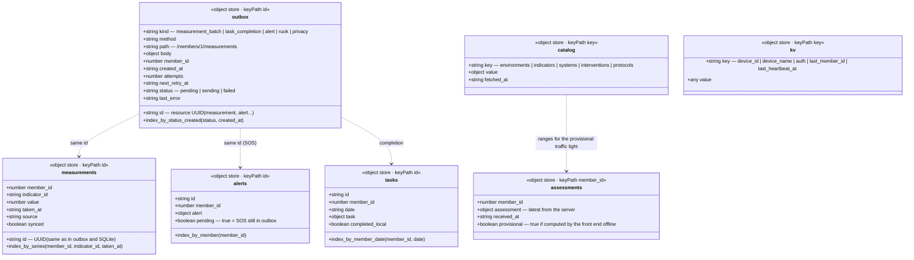
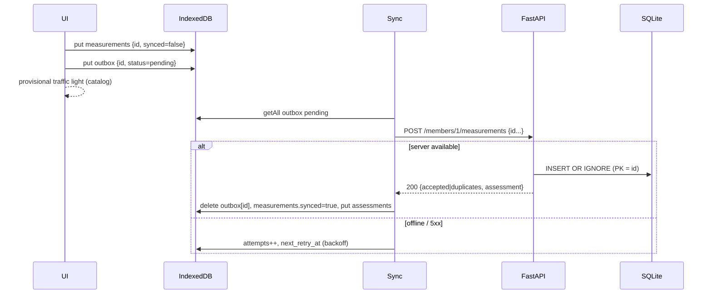

# Data model: SQLite (onboard server) and IndexedDB (device)

> Reference design for **BE-02** (SQLModel models) and **FE-11** (offline outbox). If you change a table or a store, update this document in the same PR.

## Overview



There are three data layers:
1. **JSON catalogs** (read-only, versioned in git): environments, indicators, systems, interventions, protocols and badges. **They are not tables.** Tables reference them by *slug* (`env_id`, `indicator_id`…).
2. **SQLite**: the mission's operational data. It is the source of truth.
3. **IndexedDB**: the device's outbox and cache, so that **nothing is lost** while offline. It is a partial replica and not a source of truth.

---

## 1. SQLite: `backend/ruok.db`

### Entity-relationship diagram



There is also a technical table, outside the diagram: **`app_state`** (`key TEXT PK`, `value JSON`). It stores the demo clock offset (`clock_offset_s`), the seed version and the active scenario.

### Dictionary and rules per table

| Table | Key notes | Issue |
|---|---|---|
| `user_account` | Local login. `UNIQUE(username)` and `UNIQUE(member_id)`. Lockout after 5 failures with `failed_attempts`/`locked_until`. See [auth-and-roles.md](auth-and-roles.md). | BE-25, BE-26 |
| `member` | Each environment has its own members (`env_id`). `last_seen_at` is updated by the heartbeat and liveness is derived from it (not stored). | BE-02, BE-05, BE-12 |
| `measurement` | **Append-only, never edited.** The PK is the client UUID: a retry with the same `id` and the same content returns 200, and with different content, 409. The check-in and the PVT are also measurements (`source`). | BE-06, BE-20 |
| `task` | Generated every day from `environment.routine`. The deterministic `id` prevents duplicates if generation runs again. | BE-18 |
| `task_completion` | `UNIQUE(task_id)`: a task is completed only once. Points and streaks **are computed** from here and not stored. | BE-18, BE-19 |
| `alert` | There is at most **one open alert per `dedupe_key`** (partial unique index). `level` is the index within the environment's escalation ladder. | BE-14, BE-15 |
| `alert_event` | *Append-only* timeline, shown by the front end as is. | BE-14, BE-15 |
| `ruok_check` | Created when the member becomes `stale`. If the timeout is reached without `responded_at`, the `no_contact` alert is created. | BE-16 |
| `link_message` | **Persistent** outbox/inbox of the simulated link. Delivered when `now() >= eta` and the link is not in `los`. Survives restarts. | BE-13 |
| `link_state` | One row per environment, editable from `/demo/link`. | BE-13 |
| `badge_award` | `UNIQUE(member_id, badge_id)`. | BE-19 |
| `kudos` | P2. | BE-23 |
| `device` | One row per device (mobile, tablet, tab). Updated on every heartbeat or request (`X-Device-Id`). | BE-29 |
| `event_log` | *Append-only* log of everything that happens. Feeds SSE and the control center. Purged after 7 days. | BE-28 |

### Indexes and constraints

```sql
PRAGMA journal_mode = WAL;
PRAGMA foreign_keys = ON;

CREATE UNIQUE INDEX ux_user_username     ON user_account(username);
CREATE UNIQUE INDEX ux_user_member       ON user_account(member_id) WHERE member_id IS NOT NULL;
CREATE INDEX ix_member_env              ON member(env_id);
CREATE INDEX ix_measurement_series      ON measurement(member_id, indicator_id, taken_at);
CREATE INDEX ix_task_member_date        ON task(member_id, date);
CREATE UNIQUE INDEX ux_task_completion  ON task_completion(task_id);
CREATE INDEX ix_alert_member_status     ON alert(member_id, status);
CREATE INDEX ix_alert_env_delivered     ON alert(env_id, delivered_at);
CREATE UNIQUE INDEX ux_alert_open_dedupe ON alert(dedupe_key) WHERE status <> 'resolved';
CREATE INDEX ix_alert_event_alert       ON alert_event(alert_id, at);
CREATE INDEX ix_ruok_member_pending     ON ruok_check(member_id) WHERE responded_at IS NULL;
CREATE INDEX ix_link_due                ON link_message(env_id, state, eta);
CREATE UNIQUE INDEX ux_badge_award      ON badge_award(member_id, badge_id);
CREATE INDEX ix_device_user            ON device(user_id, last_seen_at);
CREATE INDEX ix_event_env_id           ON event_log(env_id, id);
CREATE INDEX ix_event_type_at          ON event_log(type, at);
```

**Conventions:**
- All dates are stored in UTC, as ISO-8601, and are always obtained with `clock.now()`.
- `json` fields are stored as TEXT with `sa_type=JSON` in SQLModel.
- `event_log` **deliberately declares no foreign keys**: it is an *append-only* log that must not fail if a member or a device is deleted. The relationships in the diagram are logical.

### Referenced JSON catalogs (not tables)



`member.env_id`, `measurement.indicator_id`, `alert.system_id`, `badge_award.badge_id` and `task.task_type` are validated against these catalogs in the service layer, because there are no foreign keys to JSON.

---

## 2. IndexedDB: one database per device, `ruok-<device_id>` (v1, `idb` library)

> The `device_id` is stored in `localStorage` (real device) or in `sessionStorage` (each tab is a device, for rehearsals). `?device=<name>` pins a named one. See [control-center-and-devices.md](control-center-and-devices.md#4-device-identity-and-isolation).

A device can work without the onboard server. IndexedDB stores:
- **what is still to be sent** (outbox);
- **what is needed to keep working** (catalog, last assessment, protocols).



### Rules
| Store | Written by | Read by | Purged |
|---|---|---|---|
| `outbox` | Every front-end write, **before** calling the API | The synchronizer (`online` event + backoff) | On a 2xx response, including the "duplicate" response |
| `measurements` | When recording a measurement (`synced=false`) and when downloading history | Offline history and charts, provisional traffic light | Kept for 30 days |
| `assessments` | Server response, or the provisional calculation | Offline dashboard | Overwritten |
| `catalog` | On startup with a connection | Offline forms, ranges, protocols and interventions | Overwritten |
| `alerts` | Local SOS (`pending=true`) and server alerts | Alerts panel and "No enviado" (Not sent) notice | Resolved ones, after 7 days |
| `tasks` | Today's tasks and local completions | Offline missions | Days older than today minus 2 are removed |
| `kv` | `device_id` (UUID generated once), `device_name` (`?device=`), `auth` = `{token, user, exp}` (FE-27) and `last_member_id` (for the SOS without a session). **The UI session** (environment, member, vocabulary: Zustand store) **does not go here**: it is stored in `localStorage` under the key `ruok-session-<device_id>` (FE-02/FE-30) | The whole app | `auth` is cleared on logout. The outbox is **never** cleared by a logout or a 401 |

### Synchronization flow



**Guarantee:** the `id` is the same in IndexedDB, in the request body and in the SQLite PK. Retrying is safe: no data is duplicated and there are no conflicts, because everything is *append-only*.
